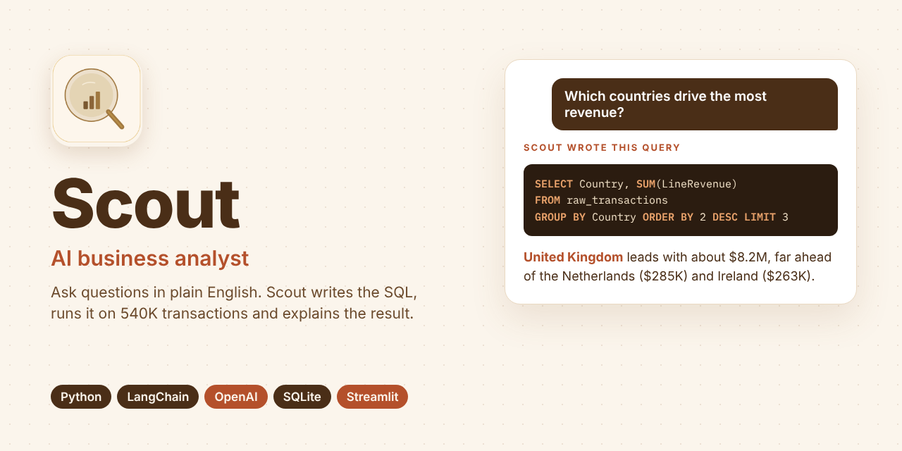

<p align="center">
  
</p>

# Scout

An AI business analyst that answers plain English questions about an online retailer's sales, expenses and profit by writing its own SQL over 540,000 transactions.

---

## What it does

Scout plays a business analyst at **The Keepsake**, a fictional online gift retailer. Instead of writing a query or building a pivot table for every question, a manager can just ask:

- "What were our top 5 products by revenue last year?"
- "Which country brought in the most revenue in Q4?"
- "What were our combined expenses in France and Germany?"
- "What's our profit in the United Kingdom?"

Scout picks the right tool, runs the query or calculation, and explains the result in business terms. Its instructions forbid it from guessing numbers, so every figure comes from the data.

## How it works

```
Manager question
       │
       ▼
Streamlit chat UI ──► LangChain agent (GPT-4o mini)
                          │
        ┌─────────────────┼────────────────────────┐
        ▼                 ▼                        ▼
  SQL tool           Expense tools          RAG retrieval
  (SQLite, 540K      (CSV lookups and       (company policies,
  transactions)      aggregation)           FAISS + OpenAI embeddings)
```

| Tool | What it does |
|---|---|
| `query_transactions` | Writes and runs read only SQL `SELECT` queries on the transactions database |
| `get_expense_value` | Looks up expenses for one country |
| `combine_expenses` | Adds up expenses for two countries |
| `calculate_profit` | Computes profit from revenue and expenses with deterministic math |

The key design choice: the language model decides **what** to compute, and Python and SQL do the actual math, which keeps the numbers exact.

## Data

- `tool_files/company.db`: 541,909 line item transactions (invoice, product, quantity, price, customer, country, revenue), based on the public [UCI Online Retail dataset](https://archive.ics.uci.edu/dataset/352/online+retail)
- `tool_files/The Keepsake expenses.csv`: operating expenses by country
- `faiss_index/`: vector index of company policy documents, used for policy and context questions

## Tech stack

Python · LangChain / LangGraph agents · OpenAI API · SQLite · pandas · FAISS · Streamlit

## Run it locally

```bash
git clone https://github.com/EstebanAnez/Scout.git
cd Scout
pip install -r requirements.txt
```

Create `.streamlit/secrets.toml` (already in `.gitignore`):

```toml
OPENAI_API_KEY = "your-openai-key"
```

Then start the app:

```bash
streamlit run App.py
```

## Project structure

| File | Purpose |
|---|---|
| `App.py` | Streamlit chat interface |
| `Scout_step_5.py` | Agent setup, system prompt and RAG retrieval |
| `Scout_tools.py` | SQL, expense and profit tools |
| `tool_files/` | Transactions database and expenses file |

---

Built by [Esteban Añez](https://www.linkedin.com/in/esteban-anez) · MBA/MSBA, University of Kansas
